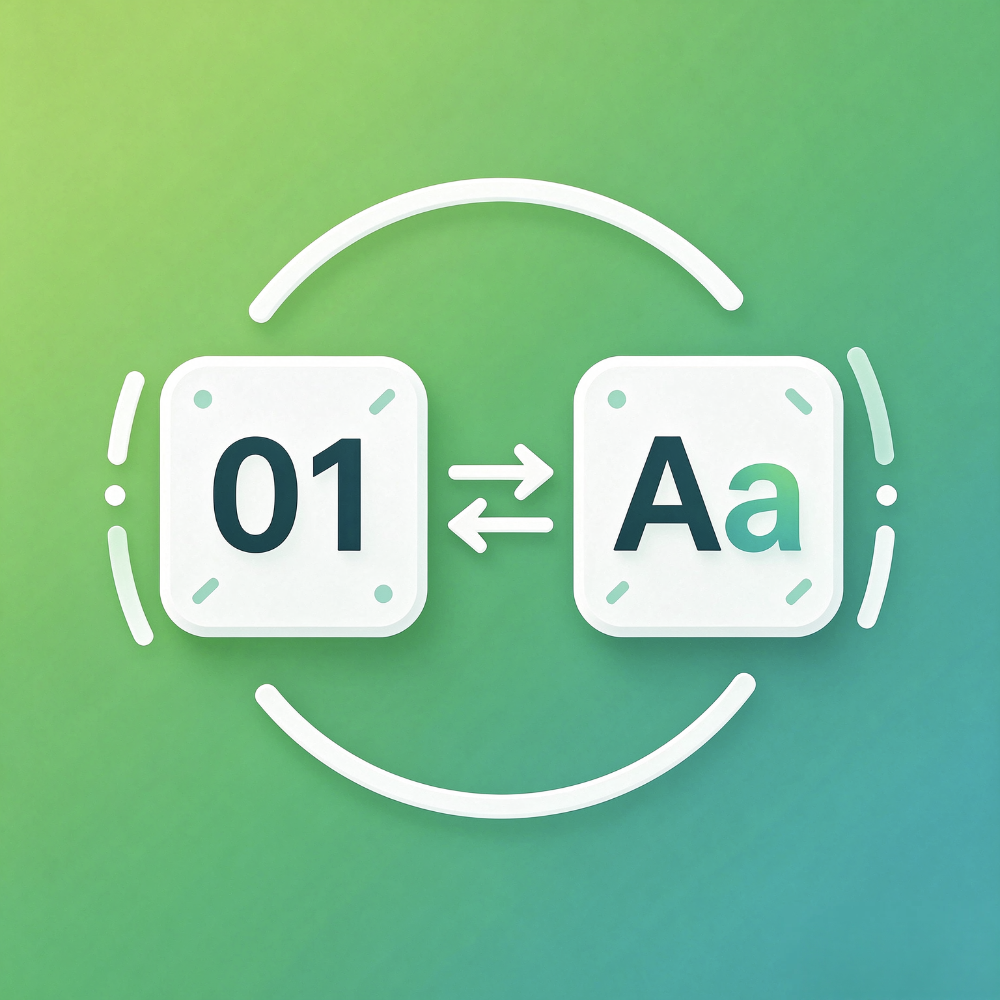

# 文本字节集转换器（text-byte-converter）

一个使用易语言开发的 Windows 桌面小工具，支持文本与字节集之间的双向转换，可在文本内容与易语言字节集（十进制字节数组）表示形式之间互相还原。

## 功能特性

- **文本 → 字节集**：将任意文本转换为花括号包裹的字节数组，直观查看文本的底层字节数据
- **字节集 → 文本**：将字节集数组还原为原始文本，便于数据验证与逆向分析
- 一键切换转换方向，界面实时显示当前所处模式
- 纯本地运行，无需联网，不依赖任何外部服务

## 使用方法

1. 运行 `文本和字节集转换器.exe`，也可用易语言打开源码自行编译。
2. 点击左上角 **切换模式** 选择转换方向：
   - **文本转换到字节集**：在“文本”编辑框输入内容，点击 **开始转换**，“字节集”框中输出 `{ 72, 101, ... }` 形式的字节数据。
   - **字节集转换到文本**：在编辑框中粘贴字节集数组，点击 **开始转换**，即可还原出对应的原始文本。

## 运行环境

- Windows 7 及以上系统
- 直接运行 exe 无需安装易语言；如需修改源码，请使用易语言 5.x 打开 `.e` 文件
- 源码依赖支持库：系统核心支持库、特殊功能支持库

## 项目结构

| 文件 | 说明 |
|---|---|
| `字符集和文本互相转换器.e` | 易语言源码文件 |
| `文本和字节集转换器.exe` | 编译后的可执行程序 |
| `文本和字节集转换.ico` | 程序图标 |
| `文本和字节集转换.png` | 项目封面图 |
| `.gitignore` | Git 忽略规则，编译产物不纳入版本管理 |

## 许可证

本项目基于 [MIT License](LICENSE) 开源。
